# Character sheet examples

Eleven unretouched sheets featuring ten original fictional characters: **five women and five men**, now shown across seven sheet layouts. Preset 7 adds a second sheet of Lin using the existing reference portrait.

[Workflow guide](../README.md) · [Public workflow](../example_workflows/H3%20Single%20Image%20Fizgig%20-%20Public.json) · [Sample settings](metadata.json) · [Hugging Face page](https://huggingface.co/aptech0081/H3-Character-Sheet-Creator)

Each character has a full-resolution sheet, its generated input portrait, prompts, and fixed seeds. The reference portraits were supplied as **face + hair**; body and clothing were specified in the subject description. Exact model settings are in [metadata.json](metadata.json).

Layouts 3, 5 and 7 intentionally crop the front body panel from the neck down.

## Preset 7 — four heads above front, top and rear body views

**Lin — orbital pilot** · 1408 × 1856 · sheet index `7` · seed `42`

The top row reads left to right: **front, three-quarter facing left, profile facing right, three-quarter facing right**. Below are a front body crop from the neck to the feet, a top-down body view, and a complete rear view including the head. The canvas is **3:4 portrait**.

[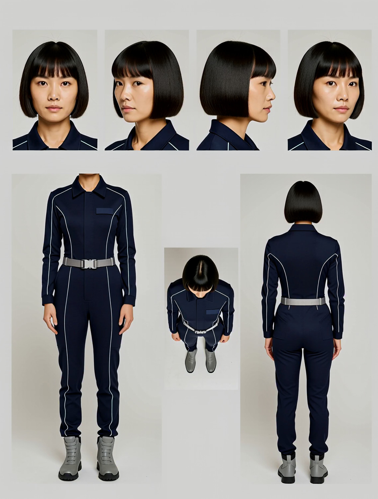](sheets/11_lin_seven_view_turnaround.png)

[Full-resolution sheet](sheets/11_lin_seven_view_turnaround.png) · [Input portrait](references/02_lin_orbital_pilot.png) · [Prompt](prompts/11_lin_seven_view_turnaround_sheet.txt)

This unretouched sample uses the revised concise prompt at seed **42**. Head angles can vary with the reference and seed.

This unretouched sample uses the public stock `minimax_h3_ref2va_int8_convrot.safetensors` overlay with the FL2VA base, **2.5 MP · 25 steps · ER-SDE · simple · CFG 1 · DMAD 0.8 · sigma shift 16/2**. It reuses the original Lin portrait. To reproduce it, load that portrait into Picture 1, select **face + hair**, copy the character description from the linked prompt into BIND 1, and use preset 7 with the seed above. Per-sample model settings are recorded in the metadata.

## Five panels — four faces and full body

### Maya — travel photographer

2464 × 1056 · sheet index `0` · seed `27101`

[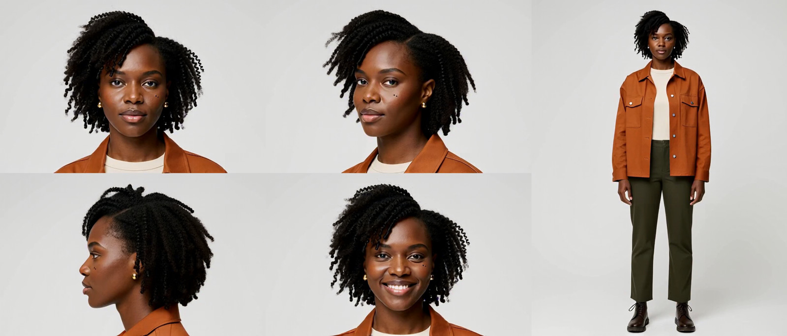](sheets/01_maya_travel_photographer.png)

[Full-resolution sheet](sheets/01_maya_travel_photographer.png) · [Input portrait](references/01_maya_travel_photographer.png) · [Sheet prompt](prompts/01_maya_travel_photographer_sheet.txt) · [Portrait prompt](prompts/01_maya_travel_photographer_reference.txt)

### Julian — city architect

2464 × 1056 · sheet index `0` · seed `27106`

[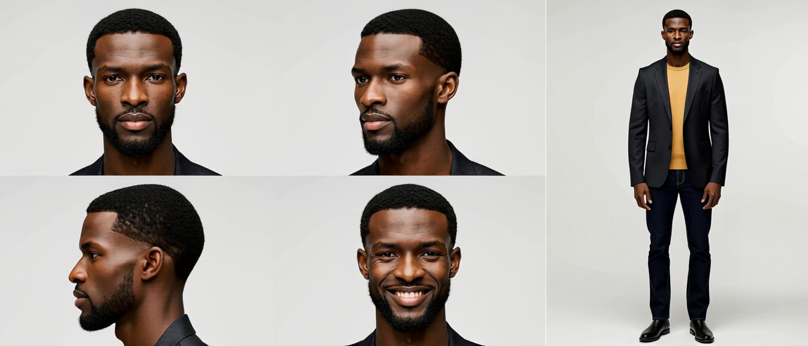](sheets/06_julian_city_architect.png)

[Full-resolution sheet](sheets/06_julian_city_architect.png) · [Input portrait](references/06_julian_city_architect.png) · [Sheet prompt](prompts/06_julian_city_architect_sheet.txt) · [Portrait prompt](prompts/06_julian_city_architect_reference.txt)

## Seven panels — angles, expressions, and full body

### Lin — orbital pilot

2464 × 1056 · sheet index `1` · seed `27102`

[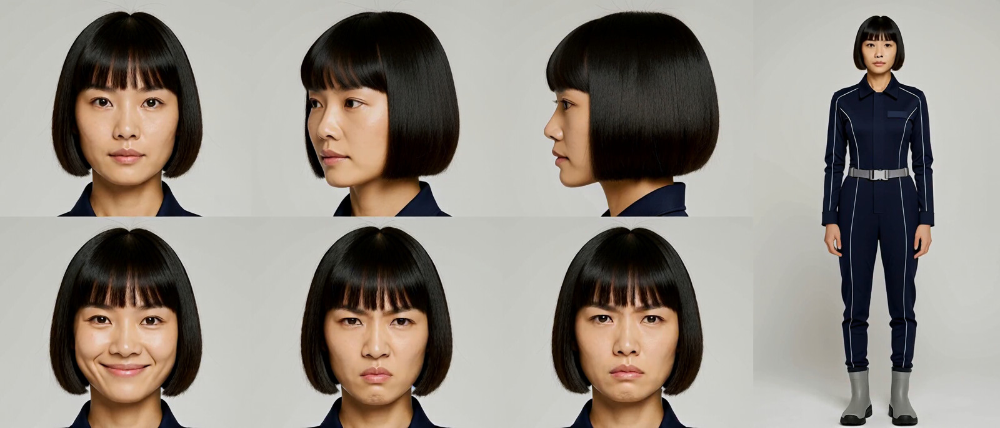](sheets/02_lin_orbital_pilot.png)

[Full-resolution sheet](sheets/02_lin_orbital_pilot.png) · [Input portrait](references/02_lin_orbital_pilot.png) · [Sheet prompt](prompts/02_lin_orbital_pilot_sheet.txt) · [Portrait prompt](prompts/02_lin_orbital_pilot_reference.txt)

### Arjun — desert ranger

2464 × 1056 · sheet index `1` · seed `27107`

[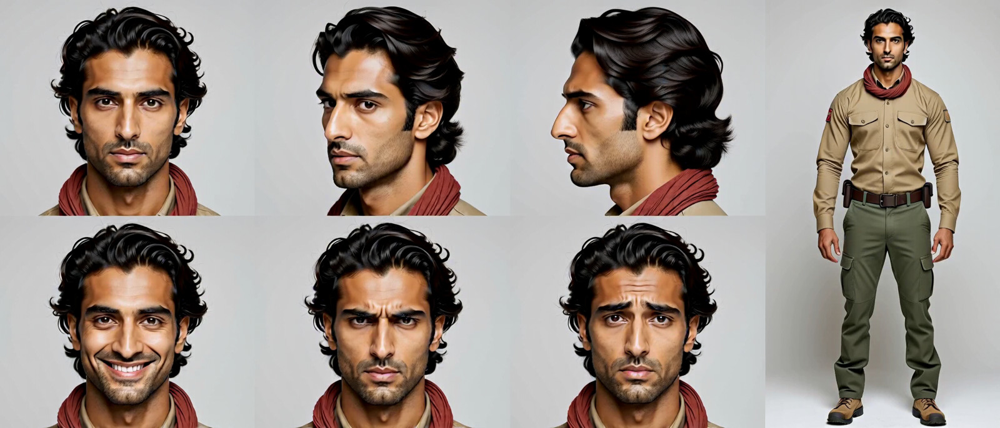](sheets/07_arjun_desert_ranger.png)

[Full-resolution sheet](sheets/07_arjun_desert_ranger.png) · [Input portrait](references/07_arjun_desert_ranger.png) · [Sheet prompt](prompts/07_arjun_desert_ranger_sheet.txt) · [Portrait prompt](prompts/07_arjun_desert_ranger_reference.txt)

## Six headshots — angles and expressions

### Leila — archaeologist

1984 × 1312 · sheet index `2` · seed `27103`

[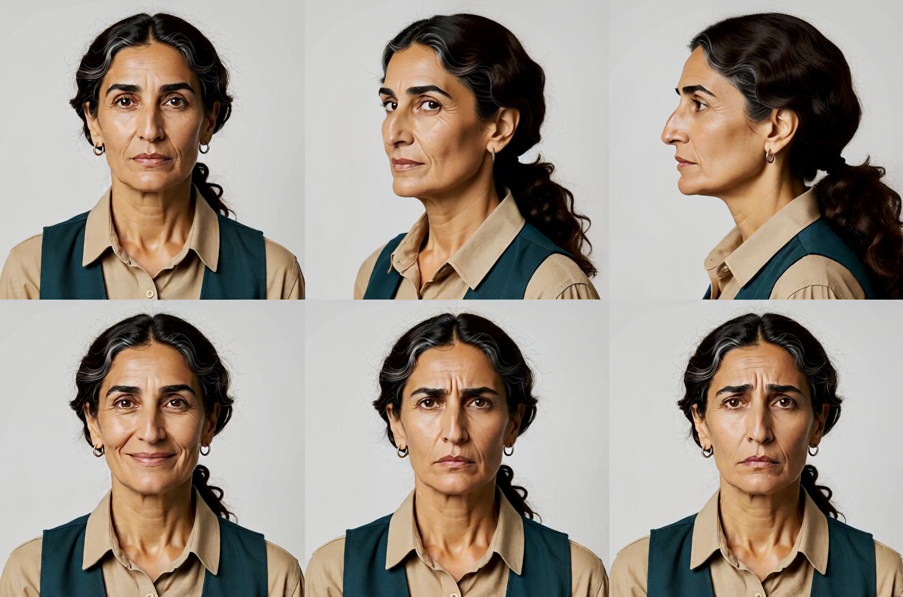](sheets/03_leila_archaeologist.png)

[Full-resolution sheet](sheets/03_leila_archaeologist.png) · [Input portrait](references/03_leila_archaeologist.png) · [Sheet prompt](prompts/03_leila_archaeologist_sheet.txt) · [Portrait prompt](prompts/03_leila_archaeologist_reference.txt)

### Kenji — retired professor

1984 × 1312 · sheet index `2` · seed `27108`

[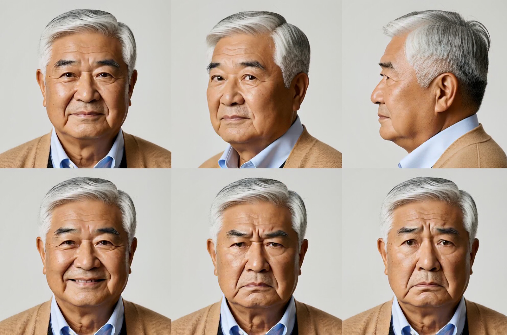](sheets/08_kenji_retired_professor.png)

[Full-resolution sheet](sheets/08_kenji_retired_professor.png) · [Input portrait](references/08_kenji_retired_professor.png) · [Sheet prompt](prompts/08_kenji_retired_professor_sheet.txt) · [Portrait prompt](prompts/08_kenji_retired_professor_reference.txt)

## Five panels — faces and clothing detail

### Aoife — Victorian botanist

2464 × 1056 · sheet index `3` · seed `27104`

[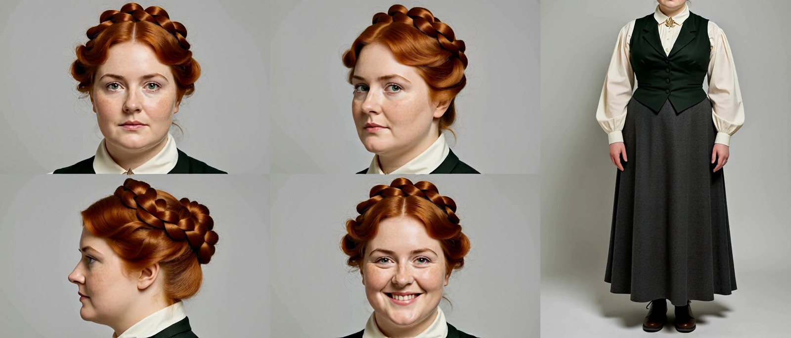](sheets/04_aoife_victorian_botanist.png)

[Full-resolution sheet](sheets/04_aoife_victorian_botanist.png) · [Input portrait](references/04_aoife_victorian_botanist.png) · [Sheet prompt](prompts/04_aoife_victorian_botanist_sheet.txt) · [Portrait prompt](prompts/04_aoife_victorian_botanist_reference.txt)

## Two portraits — front and profile

### Rowan — fantasy scholar

1984 × 1312 · sheet index `4` · seed `27109`

[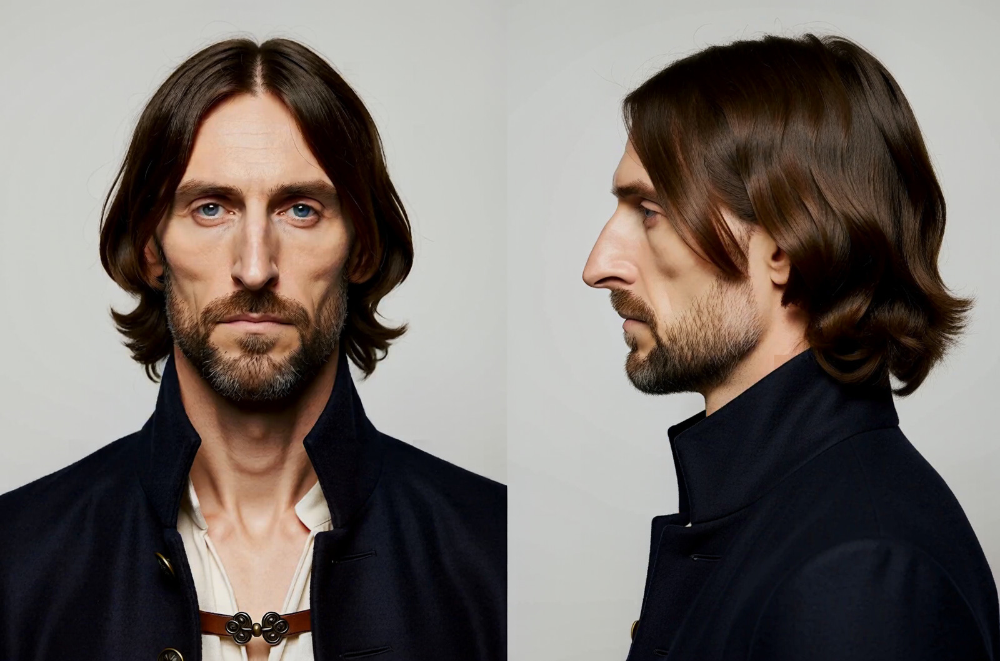](sheets/09_rowan_fantasy_scholar.png)

[Full-resolution sheet](sheets/09_rowan_fantasy_scholar.png) · [Input portrait](references/09_rowan_fantasy_scholar.png) · [Sheet prompt](prompts/09_rowan_fantasy_scholar_sheet.txt) · [Portrait prompt](prompts/09_rowan_fantasy_scholar_reference.txt)

## Three columns — front, profile, and body crop

### Ines — ceramic artist

2464 × 1056 · sheet index `5` · seed `27105`

[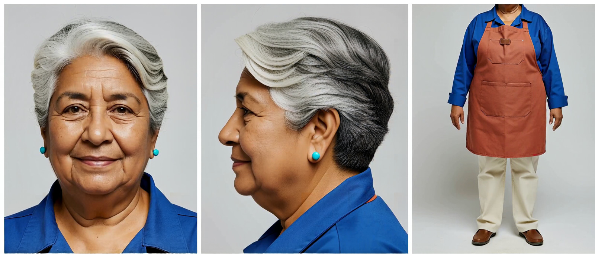](sheets/05_ines_ceramic_artist.png)

[Full-resolution sheet](sheets/05_ines_ceramic_artist.png) · [Input portrait](references/05_ines_ceramic_artist.png) · [Sheet prompt](prompts/05_ines_ceramic_artist_sheet.txt) · [Portrait prompt](prompts/05_ines_ceramic_artist_reference.txt)

### Mateo — starship mechanic

2464 × 1056 · sheet index `5` · seed `27110`

[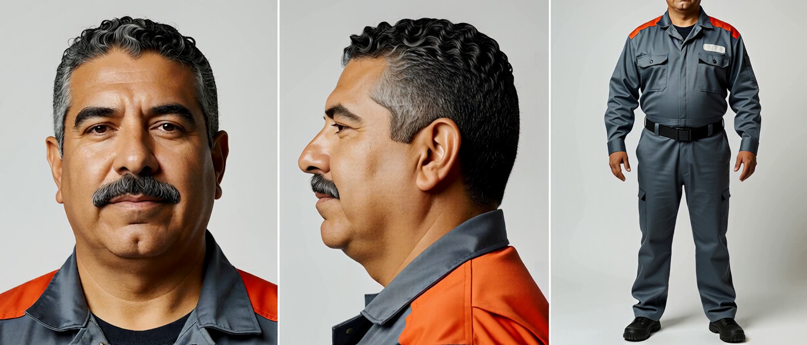](sheets/10_mateo_starship_mechanic.png)

[Full-resolution sheet](sheets/10_mateo_starship_mechanic.png) · [Input portrait](references/10_mateo_starship_mechanic.png) · [Sheet prompt](prompts/10_mateo_starship_mechanic_sheet.txt) · [Portrait prompt](prompts/10_mateo_starship_mechanic_reference.txt)
